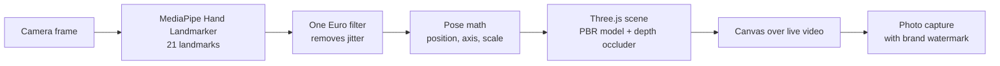
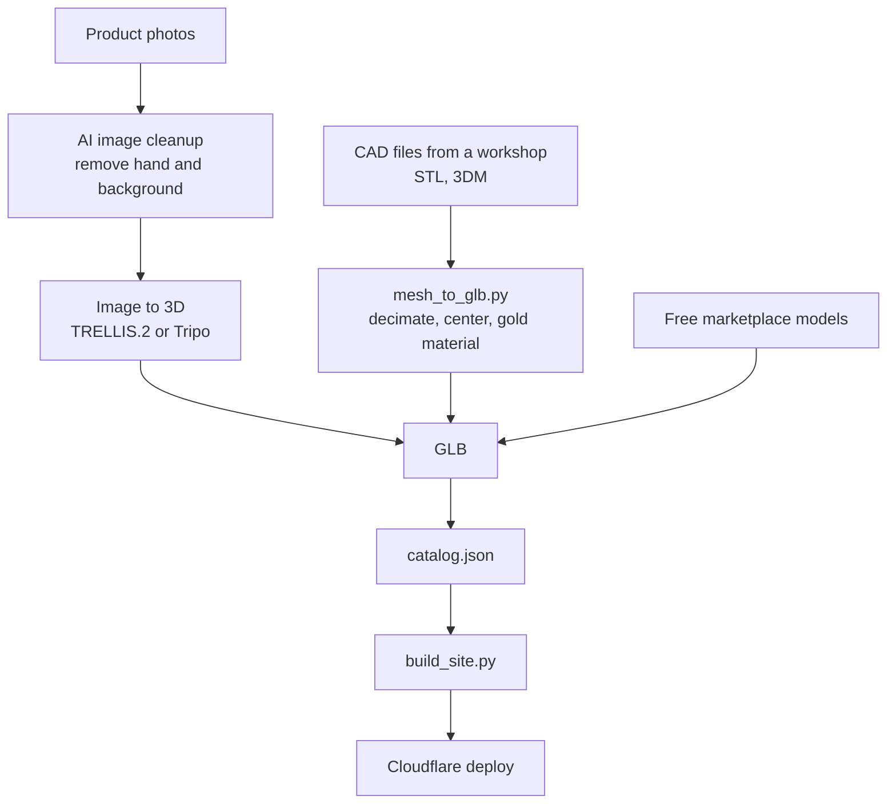

<p align="center">
  
</p>

<h1 align="center">Jewelry Virtual Try-On</h1>

<p align="center">
  <b>Try rings and bangles on your own hand, live in the browser.</b><br>
  On-device hand tracking, real 3D rendering, correct occlusion. No app, no backend, no uploads.
</p>

<p align="center">
  <a href="https://virtual-tryon-demo-9fb1.mohiey-vision.workers.dev"></a>
</p>

<p align="center">
  
  
  
  
  
  
</p>

<p align="center">
  
</p>

<p align="center">
  <a href="#-try-it-yourself">Try it</a> ·
  <a href="#-how-it-works">How it works</a> ·
  <a href="#-asset-pipeline">Asset pipeline</a> ·
  <a href="#-the-engineering-journey">Journey</a> ·
  <a href="#-skills-and-experience-gained">Skills gained</a> ·
  <a href="#-getting-started">Getting started</a> ·
  <a href="#-contact">Contact</a>
</p>

---

## ✨ Overview

A jewelry retailer wanted customers to see a piece **on their own hand before buying**, from a phone, with nothing to install. This project is the result: a static web page that opens the camera, tracks the hand in real time, and renders a 3D ring or bangle exactly where it belongs, hidden correctly behind the finger or wrist.

The retailer had **no 3D files**, so the project is as much about *getting good 3D assets cheaply and honestly* as it is about the tracking and rendering. Both halves are documented below, including what failed.

### Highlights

- **Real-time 3D try-on** of rings (on any finger) and bangles (on the wrist).
- **Correct occlusion**: the far side of a ring disappears behind the finger.
- **Privacy by design**: the camera is processed on the device. No frame ever leaves the phone.
- **Zero backend**: a static site, deployed on Cloudflare in one command.
- **Any model in, sensible result out**: GLB or OBJ files are auto-oriented and auto-scaled on load.
- **Catalog driven**: add a product by dropping a file and a line of JSON.
- **Lazy loading**: a model downloads only when the customer taps it.
- **Branded and bilingual-ready**: logo-aware UI, Arabic right-to-left interface, branded photo capture.
- **Built-in diagnostics**: an on-screen debug mode that made mobile debugging possible.

---

## 🎬 Demo

<p align="center">
  
</p>

## 📱 Try it yourself

<table>
<tr>
<td width="200" align="center">
  <br>
  <sub>Scan with your phone</sub>
</td>
<td>

1. Open the <a href="https://virtual-tryon-demo-9fb1.mohiey-vision.workers.dev">live demo</a> on a phone (or scan the code).
2. Tap **Start**, then allow the camera.
3. Pick a ring or a bangle from the bottom list.
4. Show the **back of your hand**, about 30 to 40 cm from the camera, with the whole hand in view. For bangles, keep your wrist visible.
5. Tap the camera button to take a photo. It is saved or shared from your device only.

</td>
</tr>
</table>

> **Tips**
> Good, even light helps tracking. If the piece does not appear, move the phone a little further away. Add `?debug=1` to the address to see live diagnostics (frame rate, hand detection, model loading).

---

## 🧠 How it works



### 1. Tracking

[MediaPipe Hand Landmarker](https://ai.google.dev/edge/mediapipe/solutions/vision/hand_landmarker) returns 21 landmarks per frame. Raw landmarks jitter, which makes jewelry shake, so every coordinate goes through a **One Euro filter**: it smooths hard when the hand is still and relaxes when it moves fast, which keeps latency low.

The GPU delegate is used by default, with an automatic fallback to the CPU delegate if it cannot start.

### 2. Placing a ring

- The ring sits between the finger's base joint and middle joint, a little closer to the base.
- Its **axis** follows the finger direction.
- Its **up direction** comes from the palm normal (computed from the wrist, index base and pinky base), so the stone faces the same way as the back of the hand.
- Its **size** is derived from the length of the finger segment, because finger width is roughly proportional to it. This makes the size scale naturally with the distance to the camera.

### 3. Placing a bangle

The bangle anchors on the **wrist landmark**, shifted along the forearm direction. Wrist width is estimated from the palm width, and the occluder is an ellipse (a wrist is wider than it is thick).

### 4. Occlusion

A hidden **depth-only cylinder** is rendered at the finger or wrist position. It writes to the depth buffer but not to the screen, so any part of the jewelry behind the finger fails the depth test and disappears. This is what makes the result read as "worn" instead of "pasted on".

### 5. Making arbitrary 3D models behave

Models come from many sources with different axes, units and orientations. On load, each one is **normalized automatically**:

1. The smallest bounding-box dimension is taken as the ring axis.
2. The stone side is found by comparing vertex density in the top and bottom quarter.
3. The center of the finger hole is computed from the bounding box, excluding the stone's height.
4. The model is scaled so its inner radius equals one unit.

Anything the heuristic gets wrong can be corrected per model (`axis`, `flip`, `scale`) in the catalog, using the developer mode.

### 6. Rendering

Physically based materials, image-based lighting from a procedural studio environment, ACES tone mapping, and tuned exposure and reflection intensity so polished metal does not render as black. Models that arrive without materials (OBJ, STL conversions) receive a gold PBR material.

### 7. Camera handling on real phones

Phones return different stream shapes. The page requests a **portrait stream first** and falls back to looser constraints. It resets digital zoom to its widest setting when the device exposes it, and chooses between *cover* and *contain* scaling depending on how far the stream shape is from the screen shape, so the customer never sees an unexpectedly cropped hand. The front camera is mirrored like a mirror; the rear camera is not.

---

## 🧰 Asset pipeline

The client had no CAD or 3D files, so I evaluated every realistic route. This is the honest summary.



| Route | What I learned |
|---|---|
| **Free marketplace models** | Fastest way to test the system. Quality, orientation and licenses vary a lot. Always read the license. |
| **Image-to-3D (TRELLIS.2, Tripo)** | Gets the overall shape and, importantly, **keeps the finger hole** on simple rings. Fine engraving and small stone pavé are **lost**. Free tiers have quotas, and some free plans publish your results publicly. |
| **AI-cleaned photos as input** | Removing the hand and background with an image model gives a much better 3D input, but it can **silently change design details** (stone count, tail shape). Every result must be compared with the original product before it is shown to a client. |
| **CAD files (STL, 3DM)** | Highest fidelity. Files are huge, so they are decimated from over a million faces to about 120 thousand, which brings a model to roughly 2 MB. Multi-part exports sometimes arrive as exploded parts and cannot be auto-assembled. |

**Size budget:** 12 models in the current catalog total about 36 MB, and each is fetched only when selected.

---

## 🛠 The engineering journey

How the project evolved, in the order it actually happened.

1. **Feasibility.** A 2D image overlay is quick to build but cannot rotate, cannot be occluded, and its highlights are baked in. I chose **3D with tracking** and treated the 2D version as a marketing-only fallback.
2. **First prototype.** MediaPipe plus Three.js, with procedural rings, to prove tracking, filtering and occlusion before spending time on assets.
3. **Loading real models.** Added GLB and OBJ loading, then the auto-orientation heuristic, after discovering that every downloaded model used a different axis.
4. **Asset experiments.** Free models, image-to-3D, AI photo cleanup, CAD conversion. The conversion tool was written once the first million-face files arrived.
5. **Bangles.** Added wrist anchoring and a separate occluder shape.
6. **Productizing.** `catalog.json`, lazy loading, per-model corrections, thumbnails generated from the models themselves, a clean mobile UI, logo support, and a branded capture.
7. **Deployment.** Static hosting on Cloudflare Workers with a scripted build.
8. **Real-device debugging.** The hardest part, summarized below.

### Problems found on real devices, and how they were solved

| Symptom | Cause | Fix |
|---|---|---|
| Nothing loaded, with no error shown | Loader failures were swallowed silently | Loading now reports success or failure per model, with retry on tap, and a debug overlay |
| Some models never appeared | Models compressed with Draco or Meshopt were not supported | Added both decoders |
| `dbg is not a function` froze the page on start | A debug element with `id="dbg"` became a browser global that **collided with a function inside the MediaPipe WebAssembly glue code** | Renamed the element. Lesson: avoid DOM ids that match global names used by third-party code |
| Hand looked zoomed in on phones | The camera returned a landscape stream on a portrait screen and the page cropped it to fill the screen | Portrait-first constraints, zoom reset, adaptive cover or contain |
| Tracking failed with the hand filling the screen | The wrist and fingers were cut off | Hand guide overlay and an on-screen "move back a little" hint |
| Dark, flat metal | Fully metallic materials with weak environment light | Brighter environment, higher reflection intensity, tuned exposure |
| Package installed but "module not found" | `pip` and `python` pointed to different Python installs | Use `python -m pip` |
| Dashboard upload kept resetting | Browser-based folder upload was unreliable | Deployed from the command line with Wrangler |
| Free-tier quota exhausted mid-experiment | Shared GPU quotas on a hosted demo | Fell back to another service, and kept experiments small and deliberate |

---

## 🎓 Skills and experience gained

**Computer vision and AR**
- Landmark-based pose estimation and turning 2D/3D landmarks into a stable object pose.
- Temporal filtering (One Euro) to trade smoothness against latency.
- Occlusion with depth-only geometry, and mapping between image space and a rendered scene, including mirrored cameras and cropped video.

**3D graphics**
- glTF and GLB, PBR materials, image-based lighting, tone mapping.
- Mesh normalization heuristics for unknown models, quadric decimation, Draco and Meshopt compression.

**3D asset pipelines**
- Comparing image-to-3D services honestly: what they preserve, what they destroy, and how to verify output against the real product.
- Converting CAD exports to web-ready GLB with Python (`trimesh`).
- Understanding and respecting model licensing.

**Web engineering**
- No-build ES modules with import maps, lazy loading, resource budgets for mobile.
- Camera APIs on real phones: HTTPS requirement, stream constraints, aspect ratios, zoom, permissions, error taxonomy.
- Web Share API and canvas compositing for photo capture.
- Building **observability into a client-side app**: an on-screen diagnostics overlay turned guesswork into evidence.

**Delivery and DevOps**
- Static deployment with Cloudflare Workers and Wrangler, temporary HTTPS tunnels for phone testing, a scripted build with size checks.
- Git hygiene for projects that depend on third-party licensed assets.

**Product and client work**
- Scoping when the client has no assets, setting honest expectations about fidelity and accuracy.
- Privacy by design, Arabic right-to-left UX copy, brand integration (transparent logo tinting and watermarking).
- Debugging methodically: reproduce, instrument, read the evidence, then change one thing.

---

## 🗂 Project structure

```
index.html              the whole application (UI, tracking, rendering)
catalog.json            brand, logo and product list
build_site.py           assembles the deployable ./site folder
tools/mesh_to_glb.py    STL / OBJ / GLB to optimized GLB
docs/                   README assets (logo, demo GIF, QR code)
models/                 GLB files          (not committed)
thumbs/                 product thumbnails (not committed)
source/                 raw downloads      (not committed)
```

### Design decisions

| Decision | Why | Trade-off |
|---|---|---|
| Static site, no backend | Privacy, near-zero hosting cost, trivial deployment | No server-side analytics or accounts |
| 3D rendering instead of a 2D overlay | Rotation, occlusion and lighting look real | Needs 3D models per product |
| On-device tracking | No video leaves the phone | Performance depends on the phone |
| Auto-orient and auto-scale models | Accepts models from any source | Heuristics need per-model overrides now and then |
| Lazy loading | Fast first screen on mobile data | A short wait when selecting a piece |

---

## 🚀 Getting started

### Run locally

```bash
python -m http.server 8000
```

Open `localhost:8000` in Chrome. The camera works on localhost without HTTPS.

### Add a product

1. Put the GLB file under `models/rings/` or `models/bangles/`.
2. Add an entry to `catalog.json`:

```json
{
  "brand": "Display name",
  "logo": "logo.png",
  "logoStyle": "gold",
  "items": [
    { "id": "ring-001", "type": "ring", "file": "models/rings/ring-001.glb",
      "thumb": "thumbs/ring-001.png", "name_ar": "...", "name_en": "...",
      "axis": 2, "flip": false, "scale": 1.0 }
  ]
}
```

`type` is `ring` or `bangle`. `axis`, `flip` and `scale` are optional corrections. `logoStyle` is `gold` (tints a transparent PNG with a gold gradient), `original`, or `plate` (ivory card).

### Convert 3D files

```bash
pip install trimesh numpy fast-simplification
python tools/mesh_to_glb.py source/piece.stl models/bangles/bangle-002.glb
python tools/mesh_to_glb.py source/set.glb --inspect
python tools/mesh_to_glb.py source/set.glb models/bangles/b.glb --parts 0,2
```

### Build and deploy

```bash
python build_site.py
npx wrangler deploy site --name <project-name>
```

`build_site.py` copies only what the catalog references and fails if any model exceeds the 25 MiB per-file upload limit.

### Developer tools (query parameters)

| Parameter | Purpose |
|---|---|
| `?dev` | Axis, flip and scale controls, plus a button that prints the per-model settings to paste into the catalog |
| `?debug=1` | Live diagnostics: frame rate, hand detection, camera size, model loading, errors |
| `?thumbs` | Renders one transparent PNG per product and downloads them |
| `?delegate=cpu` | Forces the CPU hand-tracking delegate |

---

## ⚠️ Known limitations

- Fine engraving and tiny pavé stones do not survive decimation or image-to-3D conversion.
- Sizing uses fixed hand proportions. Measuring against a reference object (for example a bank card) would improve real-world accuracy.
- Tested on desktop and Android Chrome. iOS Safari still needs a proper test pass.
- Necklaces are not supported yet.

## 🗺 Roadmap

- Necklaces and earrings with face and pose tracking.
- Reference-object calibration for true ring size.
- Engraving through normal maps on top of simplified meshes.
- Self-hosted tracking assets (no third-party CDN dependency).
- Installable web app, and a retailer-facing dashboard for managing the catalog.

---

## 📄 Assets and licensing

3D models, brand logos and product designs are **not** part of this repository and belong to their respective owners. Check the license of every model before using it, and do not redistribute files you do not have the rights to.

© 2026 Mohiey Elkiouty. All rights reserved.

---

## 📬 Contact

Built by **Mohiey Elkiouty**, Computer Vision and AI Engineer. If you want to build something similar, or just talk about computer vision on the web, get in touch.

<p align="center">
  <a href="https://www.linkedin.com/in/mohiey-elkiouty/"></a>
  <a href="https://www.freelancer.com/u/mohymohamed004"></a>
  <a href="mailto:mohymohamed004@gmail.com"></a>
</p>

<p align="center">
  <a href="https://www.linkedin.com/in/mohiey-elkiouty/">LinkedIn</a> ·
  <a href="https://www.freelancer.com/u/mohymohamed004">Freelancer</a> ·
  <a href="mailto:mohymohamed004@gmail.com">mohymohamed004@gmail.com</a>
</p>

